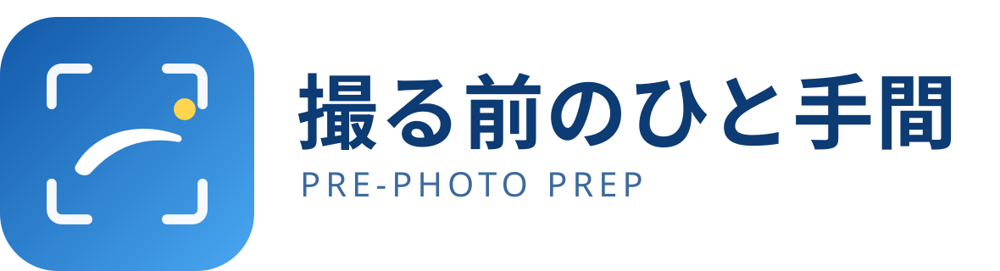
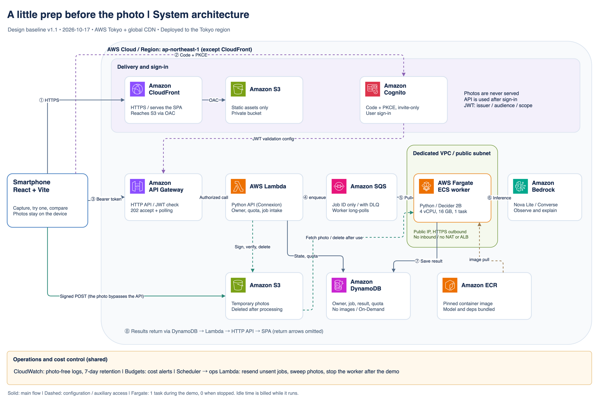
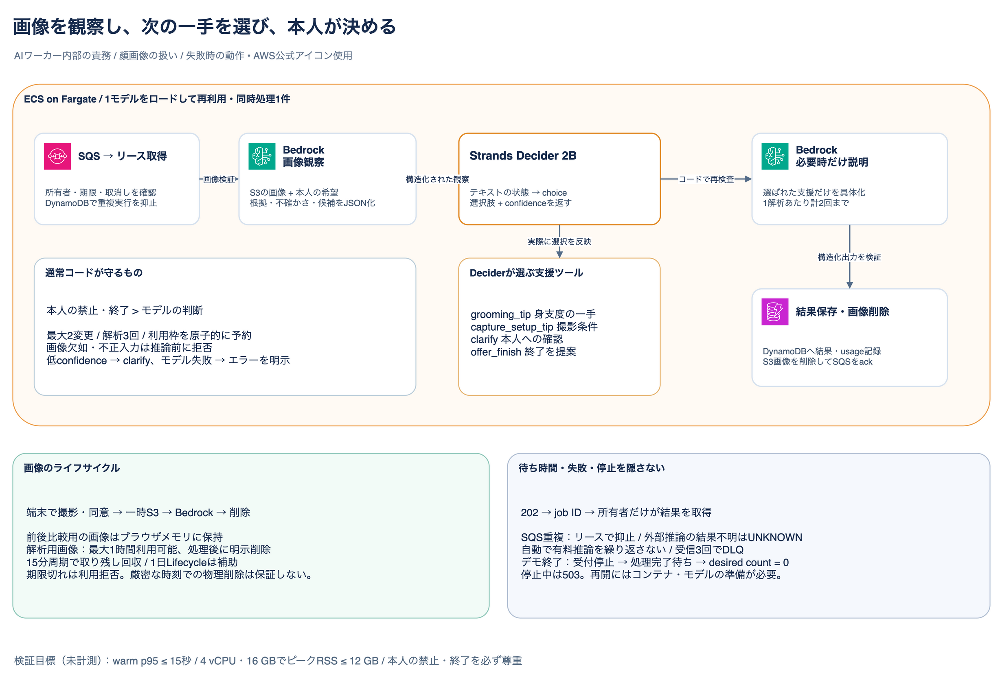
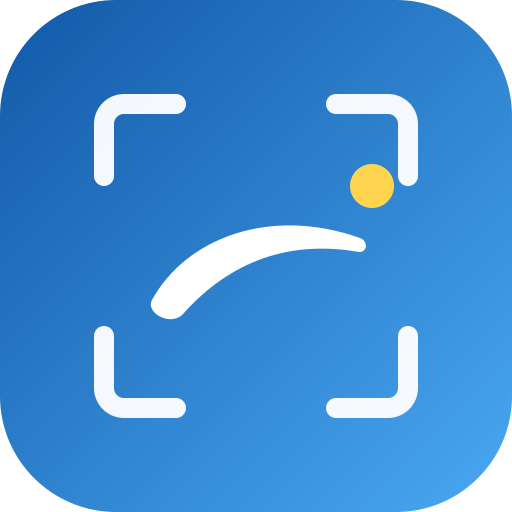

# A little prep before the photo (撮る前のひと手間)

<p align="center"></p>

[日本語版はこちら → README_ja.md](README_ja.md)

A submission to the [AWS Agent Experience Hackathon: Strands Decider](https://builder.aws.com/build/hackathons/4f50957c-1d08-37ab-b11c-97516b9adeb4/agent-experience-hackathon-strands-decider).

**Tags: `#strands-decider-2b` `#tool-selection`** · License: [MIT](LICENSE) (OSI approved) · [Third-party notices](docs/THIRD_PARTY_NOTICES.md)

## Overview

Before an ID or profile photo, you pick **one** small change (your brows or your bangs), try it, take a
second photo, compare before and after, and choose for yourself. The app never rates your appearance, never
suggests more than one thing at a time, and lets you stop at any moment.

The interesting part is who decides what:

- **Strands Decider 2B** decides *which kind of help comes next*: a grooming tip, a tip about the shooting
  setup, a clarifying question, or an offer to finish.
- **Amazon Bedrock (Nova Lite)** looks at the photo and writes the explanation, only when the Decider's
  choice needs one.
- **Ordinary code (guards)** enforces what must always hold, whatever a model says: your explicit
  restrictions, the two-change limit, and ending when you say so.

The decision structure is extracted as a reusable pattern, see [Decision pattern](#decision-pattern-tool-selection).

## Features

- **Four screens**: Consult (what to look at, an optional wish, consent) → First photo → Try one thing →
  Compare and choose.
- **One suggestion at a time**, at most **two changes** and **three analyses** per session. You can finish
  at any moment, from any screen.
- **Your restrictions are honored in code**, not just in a prompt (for example "do not touch my brows").
- **Honest about what cannot be seen**: backlight, dim light, a face out of frame or a photo that cannot be
  compared with the earlier one lead to a single shooting tip or a retake, never to a confident claim.
- **Privacy by design**: the photo is sent to the cloud only after you agree, is deleted right after
  processing (and when you end the session), and the photos used for comparison stay in the browser's memory
  on your device. Logs contain ids and option names, never photos or your words.
- **Japanese and English** UI and advice, switchable at any time (the advice follows the chosen language).
- **Installable (PWA)**: add it to the home screen. The service worker only caches the static app shell; it
  never touches the API, S3, Cognito, the sign-in callback or photos.
- **Invitation-only sign-in** with Amazon Cognito (Authorization Code + PKCE).
- **Cost controls**: the worker runs only when started, scales to zero, and the app enforces per-person and
  daily quotas. A "door" tells you when the service is closed or warming up, instead of failing.

## Architecture



> A Japanese version is [`system-overview.png`](docs/architecture/diagrams/system-overview.png). The editable
> sources are [`photo-prep.en.drawio`](docs/architecture/diagrams/photo-prep.en.drawio) (English) and
> [`photo-prep.drawio`](docs/architecture/diagrams/photo-prep.drawio) (Japanese): two pages each, official AWS icons.

| Piece | What it does |
| --- | --- |
| **SPA** (S3 + CloudFront with OAC) | React app served from a private bucket. Takes the photo in the browser. |
| **Amazon Cognito** | Invitation-only sign-in, Authorization Code + PKCE, public client. |
| **API Gateway HTTP API + Lambda** | JWT authorizer, then ownership checks in code. Python (Connexion + Mangum) built from the OpenAPI file. Accepts a request (202) and returns the result later. |
| **S3 (images)** | Private bucket for temporary photos. The browser uploads with a signed POST, so photos never pass through the API. |
| **DynamoDB** | Sessions, jobs, results, quotas and the service status. No images. |
| **SQS (+ dead-letter queue)** | Carries only the job id to the worker. |
| **ECS on Fargate worker** | Python worker (4 vCPU / 16 GB, one job at a time) that loads Strands Decider 2B once and calls Bedrock. In a public subnet with no inbound traffic; no NAT gateway or load balancer. |
| **Amazon Bedrock** | Nova Lite (Converse API, Tokyo) observes the photo and explains. |
| **Operations Lambdas** (EventBridge Scheduler) | Redispatch unsent jobs, sweep leftover images, start/stop and reconcile the worker. |
| **CloudWatch, Budgets** | Logs without images; budget e-mails (a notification, not a spending limit). |

The AI part of the worker, in detail:



More: [architecture baseline](docs/architecture/README.md) ·
[why these technologies](docs/architecture/technology-selection.md) ·
[cost estimate](docs/architecture/cost-estimate.md).

## How we use Strands Decider and Amazon Bedrock

One analysis goes through four steps (code: [`apps/worker/src/photoprep_worker/`](apps/worker/src/photoprep_worker/)):

1. **Bedrock observes** (`observe.py`). Nova Lite gets the photo and the scope and must answer with a JSON
   object: what is visible, what is uncertain, lighting, framing and a confidence. The answer is validated
   (pydantic); anything else fails the job instead of being guessed at. The prompt says not to infer what is
   not visible and to ignore any text written in the photo.
2. **The Decider chooses** (`decider.py`). The Decider never sees the image. It gets a *text state*: the
   scope, the person's wish and restrictions, the observation, how many changes were used, the last advice.
   It answers a **typed choice question** with four options, each with a plain description of when it is right:
   `grooming_tip`, `capture_setup_tip`, `clarify`, `offer_finish`. We get back a probability for every option
   and a confidence.
3. **Guards overrule when they must** (`guards.py`). A missing or unreadable photo, an explicit restriction,
   the two-change limit and "the person chose to finish" are checked in ordinary code. An override carries a
   reason code that is recorded.
4. **Only the selected tool runs** (`pipeline.py`, `explain.py`). `grooming_tip` calls Bedrock a second time
   to write one short, undoable suggestion. The other three use fixed, neutral wording and call no model.

What we did on purpose:

- **The Decider's choice changes what runs**, not just what is logged. Each option is wired to a handler and
  only the chosen handler executes. Bedrock is called at most twice per analysis (one observation, at most one
  explanation, 800 output tokens each, temperature 0), and a failed call is never replaced by canned advice
  that looks like the model wrote it.
- **Models are not trusted with rules.** In our smoke test the Decider still chose `grooming_tip` when the
  state said "do not touch the brows"; the guard replaced it with `clarify` and recorded `restriction`.
  That is why restrictions and limits live in code.
- **We did not invent a confidence threshold.** Sensible choices came back with a confidence around 0.69, so a
  fixed "reject below 0.8" would have thrown them away. The confidence guard is switched off until it can be
  calibrated on evaluation data, and the confidence is never shown as "the probability the advice is right".
- **Every decision leaves a record** (`DecisionRecord`: the options, probabilities, confidence, override reason
  and which models ran), with no image and none of the person's words. An export tool turns them into a
  demonstration table.
- **Reproducible and offline**: the Decider and its base weights are fetched at image build time from pinned
  revisions (the build fails if the Hub moved), and nothing is downloaded at run time.
- **A small, honest surface for the user**: one suggestion, no scores, a comparison the person judges.

### Decision pattern (`#tool-selection`)

"Typed question → Decider's choice → guards → only the chosen tool runs" is packaged on its own:
[docs/decision-pattern.md](docs/decision-pattern.md), code in
[`apps/worker/src/photoprep_worker/decision_pattern/`](apps/worker/src/photoprep_worker/decision_pattern/)
(copy that directory into another app; tests check it depends on nothing else here). A runnable example:

```sh
cd apps/worker && PYTHONPATH=src uv run python -m photoprep_worker.decision_pattern.example
```

## Tech stack

Full table with the status of every choice: [docs/tech-stack.md](docs/tech-stack.md).

| Area | Technology |
| --- | --- |
| Frontend | React 19, TypeScript, Vite 8, Material UI, TanStack Query, hand-written i18n (ja/en), PWA (manifest + service worker) |
| API contract | OpenAPI 3.0.3 YAML as the source of truth ([`packages/api-spec`](packages/api-spec/openapi.yaml)); Orval generates the TypeScript client |
| API | Python 3.12, Connexion 3 + Flask, Mangum on AWS Lambda, boto3 |
| Worker | Python 3.12, PyTorch (CPU), Strands Decider 2B, pydantic, Pillow; Docker image on Amazon ECR |
| AI | Strands Decider 2B (`StrandsAgents/strands-decider-2B-qwen3.5-v1-2610`), Amazon Bedrock Nova Lite (`amazon.nova-lite-v1:0`) |
| AWS | CloudFront, S3, Cognito, API Gateway (HTTP API), Lambda, DynamoDB, SQS, ECS on Fargate, ECR, EventBridge Scheduler, CloudWatch, Budgets (Tokyo `ap-northeast-1`) |
| Infrastructure as code | AWS CDK v2 (TypeScript) with cdk-nag |
| Tooling | pnpm workspaces, uv, Biome, Oxlint, Knip, jscpd, GitHub Spec Kit |
| Tests | pytest + moto (API, worker), Vitest + Testing Library (frontend), Jest + CDK assertions (infrastructure) |

## Getting started

### Run it locally (no AWS needed)

The frontend has a built-in **mock API** (the page shows a banner saying so). Photos stay in the browser and
the advice is fixed replay data, not a real analysis.

```sh
pnpm install
pnpm --filter frontend dev
```

Open the printed address. The mock banner lets you pick a scenario (normal, backlight, vague, failure) and the
service door state. Run the tests (none of them touch AWS):

```sh
pnpm --filter frontend test
(cd apps/api && uv sync && uv run pytest)
(cd apps/worker && uv sync && uv run pytest)
pnpm --filter cdk test
```

### Deploy to AWS

You need: Node.js and pnpm 10.32.1, [uv](https://docs.astral.sh/uv/), Docker, the AWS CLI signed in to an
account with permission to deploy, Amazon Bedrock access to Nova Lite in Tokyo, and a one-time
`cdk bootstrap` for `ap-northeast-1`. **Never commit credentials or personal face photos.**

Costs: the Fargate worker is billed while it runs (about $0.30 per hour), including when idle. Everything else
is small at this scale. See the [cost estimate](docs/architecture/cost-estimate.md); the budget only sends
e-mail, it does not stop spending.

Run each `cdk` command **on its own**; two at once collide on `cdk.out`.

```sh
pnpm install
pnpm build:lambda                       # the API package (code + Linux dependencies + the OpenAPI file)
```

First deploy (the worker service starts at 0 tasks, so nothing is billed for compute yet):

```sh
cd apps/cdk && pnpm exec cdk deploy -c photoprep:alertEmail=you@example.com
```

Build and push the worker image (about 5 to 6 GB with the model weights; the repository is immutable, so use a new tag each time):

```sh
docker build --platform linux/amd64 -f apps/worker/Dockerfile -t photoprep-worker:v1 .
aws ecr get-login-password --region ap-northeast-1 | docker login --username AWS --password-stdin <account>.dkr.ecr.ap-northeast-1.amazonaws.com
docker tag photoprep-worker:v1 <WorkerRepositoryUri>:v1
docker push <WorkerRepositoryUri>:v1
```

Deploy again with the image tag (a deploy stops a running worker; add `-c photoprep:workerDesiredCount=1` to keep it
running), then create your invited user and publish the frontend:

```sh
cd apps/cdk && pnpm exec cdk deploy -c photoprep:alertEmail=you@example.com -c photoprep:workerImageTag=v1
aws cognito-idp admin-create-user --user-pool-id <UserPoolId> --region ap-northeast-1 --username you@example.com --user-attributes Name=email,Value=you@example.com Name=email_verified,Value=true --desired-delivery-mediums EMAIL
pnpm --filter frontend run publish:plan     # prints what would be uploaded
pnpm --filter frontend run publish:apply
```

Open the `SpaUrl` from the stack outputs and sign in with the temporary password that Cognito e-mails you.

### Start and stop the worker

The service is **closed until the worker is started** (the app shows why). Starting takes a couple of minutes
(image pull and model load); the door opens by itself when the model is ready.

```sh
aws lambda invoke --function-name <WorkerControlFunction> --region ap-northeast-1 --payload '{"action":"start"}' --cli-binary-format raw-in-base64-out /dev/stdout
aws lambda invoke --function-name <WorkerControlFunction> --region ap-northeast-1 --payload '{"action":"stop"}'  --cli-binary-format raw-in-base64-out /dev/stdout
```

A nightly stop (03:00 JST) and a five-minute reconcile also scale the worker to zero. More in
[docs/operations.md](docs/operations.md).

### Delete everything

1. Stop the worker (above).
2. Keep anything you want (for example `apps/worker/tools/export_decisions.py`).
3. The user pool and the table are **retained by default**. Deploy once with `destroyData=true`, then destroy
   (this deletes the Cognito users and all stored data for good):

```sh
cd apps/cdk && pnpm exec cdk deploy -c photoprep:alertEmail=you@example.com -c photoprep:workerImageTag=v1 -c photoprep:destroyData=true
cd apps/cdk && pnpm exec cdk destroy -c photoprep:destroyData=true
```

4. Check that nothing is left, and that no other `cdk` command ran in the meantime (it can recreate the stack):

```sh
aws cloudformation describe-stacks --stack-name PhotoPrepStack --region ap-northeast-1
```

5. Remove leftovers: ECR images, log groups, and the bootstrap stack if you will not use CDK again. Then check
   Billing for what remains (ECR storage, public IPv4 addresses).

## Status

A dated, honest record (2026-10-17). Details in [`specs/001-pre-photo-grooming-assist/`](specs/001-pre-photo-grooming-assist/)
(spec, plan, research, tasks).

| Item | State |
| --- | --- |
| Code | API, worker, frontend and infrastructure implemented with tests first. Tests: API 324, worker 150, frontend 110, CDK 42 (all local, Bedrock mocked) |
| Deployed to AWS | **Yes, once, for verification** (Tokyo). Sign-in, the door, photo upload, one real analysis (Nova Lite + Decider on Fargate) and the advice screen worked end to end, in English and Japanese. The compare-and-finish half has not been run on AWS. The environment is torn down after verification, so there is no public URL |
| Measured on AWS | One analysis took about 9 seconds from acceptance to result (single sample, cold worker). The worker was ready 124 seconds after being started. **Not measured**: Decider peak memory and latency on Fargate, image deletion beyond the success path, quality of the advice (in either language) |
| Known defects found only on AWS | Four, all fixed with tests: a token race after sign-in, a Lambda import error, a missing "open the door" call in the worker, and S3 upload forms signed for the global endpoint |
| Demo video and article | Drafts only ([article](docs/article/draft.md), [script](docs/demo-script.md)) with `[MEASURE]`/`[TODO]` markers; not published |
| Not done | Playwright end-to-end tests; the parts of "restrictions", "uncertain observations" and "limits" that need real photos; the Knip clean-up |

## Repository layout

```text
apps/frontend/             React app (screens, i18n, PWA, mock API, publish script)
apps/api/                  Python API for Lambda (Connexion) and the operations Lambdas
apps/worker/               Python AI worker, Dockerfile, the reusable decision_pattern package
apps/cdk/                  CDK stacks and constructs, with tests
packages/api-spec/         openapi.yaml, the contract (source of truth)
packages/photoprep-common/ State rules, DynamoDB store, log allow-list shared by API and worker
docs/                      Architecture and diagrams, tech stack, operations, article and demo drafts
docs/brand/               Logo and background images (SVG)
specs/                     Spec Kit artifacts for the feature (spec, plan, research, tasks)
```

Before making the repository public: `sh scripts/check-publishable.sh`.

## Development workflow

Work follows GitHub Spec Kit (Specify CLI 1.0.3) with the project constitution in
[`.specify/memory/constitution.md`](.specify/memory/constitution.md): `specify`, `clarify`, `plan`, `tasks`,
`implement`, with tests first. The OpenAPI YAML is edited first and the client regenerated
(`pnpm --filter frontend api:generate`); generated code is never edited by hand. Read
[docs/tech-stack.md](docs/tech-stack.md) before planning, and keep adopted choices apart from
recommendations and unverified assumptions.

## Branding

The logo and background images are plain SVG files in [`docs/brand/`](docs/brand/), released under the same
[MIT license](LICENSE) as the code. The mark shows a viewfinder (the photo to come), one brow (the one thing
to tidy) and one small yellow dot (one small touch).

| File | Use |
|---|---|
| [`logo-mark.svg`](docs/brand/logo-mark.svg) | Icon only |
| [`logo-lockup.svg`](docs/brand/logo-lockup.svg) | Icon with the name (follows light/dark) |
| [`background-landscape.svg`](docs/brand/background-landscape.svg) · [dark](docs/brand/background-landscape-dark.svg) | 1920×1080, slides and video |
| [`background-portrait.svg`](docs/brand/background-portrait.svg) · [dark](docs/brand/background-portrait-dark.svg) | 1080×1920, phone screens |

<p>
  
  
  
</p>

The text in the lockup uses installed fonts (Noto Sans JP, Hiragino Sans, Yu Gothic); convert the text to
outlines before using it in a final deliverable. The app's own favicon and PWA icons are not replaced yet.

## License

[MIT](LICENSE). AWS architecture icons are AWS's own artwork, used to explain the architecture
([notice](docs/architecture/diagrams/README.md)). Other third-party notices: [docs/THIRD_PARTY_NOTICES.md](docs/THIRD_PARTY_NOTICES.md).
