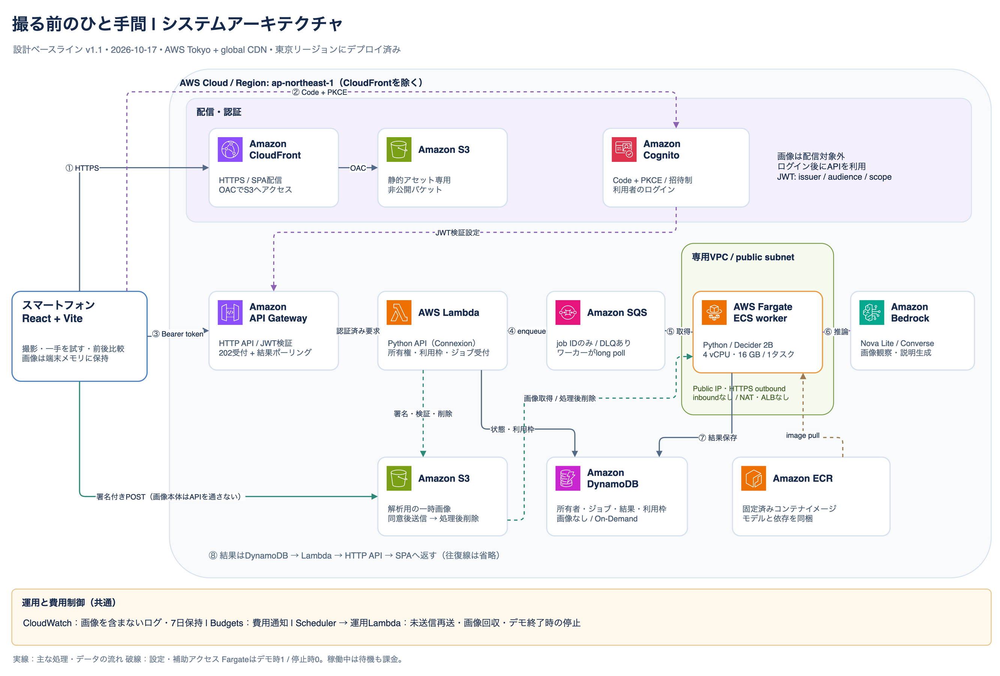

# 撮る前のひと手間（Agent Experience Hackathon: Strands Decider）

[AWS Agent Experience Hackathon: Strands Decider](https://builder.aws.com/build/hackathons/4f50957c-1d08-37ab-b11c-97516b9adeb4/agent-experience-hackathon-strands-decider) への応募プロジェクトです。

**Tags: `#strands-decider-2b` `#tool-selection`** · License: [MIT](LICENSE)（OSI承認） · [第三者ライセンス](THIRD_PARTY_NOTICES.md)

撮影前の眉・前髪を**一つだけ**整えて試し、前後を比べて本人が選ぶ体験です。エージェントは、
次にどの支援を使うか（`grooming_tip` / `capture_setup_tip` / `clarify` / `offer_finish`）を
**Strands Decider 2B** に選ばせ、画像の観察と説明は Amazon Bedrock（Nova Lite）が担います。
禁止・上限・終了は通常のコード（ガード）が守ります。

## 再利用できる判断パターン（#tool-selection）

「型付きの問い → Decider の選択 → ガードによる上書き → 選ばれたツールだけが実行される」を
独立したパッケージにしています。説明と使い方は [docs/decision-pattern.md](docs/decision-pattern.md)、
コードは [`apps/worker/src/photoprep_worker/decision_pattern/`](apps/worker/src/photoprep_worker/decision_pattern/) です
（他のアプリへはこのディレクトリをコピーして使えます。テストで、アプリの他の部分に依存しないことを確認しています）。

## 現在の状態（2026-10-17 時点・正直な記録）

| 項目 | 状態 |
| --- | --- |
| 仕様・計画・タスク | [`specs/001-pre-photo-grooming-assist/`](specs/001-pre-photo-grooming-assist/) |
| API・ワーカー・フロント・CDK | ローカルで実装・テスト済み（API 183件、ワーカー126件、フロント22件、CDK 17件）。BedrockとフロントのAPIは**モック** |
| Deciderの実機確認 | 開発Mac（CPU）で動作確認。Fargateでの性能は**未測定** |
| AWSへのデプロイ・実Bedrock・実カメラ | **未実施** |
| デモ動画・記事 | 下書きのみ（[記事](docs/article/draft.md)、[台本](docs/demo-script.md)）。**公開・撮影は未実施** |

## ローカルで動かす（モックAPI）

```sh
pnpm install
pnpm --filter frontend dev      # 画面にモック動作中のバナーが出ます。AWSにはつながりません
pnpm --filter frontend test     # 画面とモックの通しテスト
(cd apps/api && uv sync && uv run pytest)
(cd apps/worker && uv sync && uv run pytest)
(cd apps/cdk && pnpm test)      # デプロイはしません
```

公開前の確認: `sh scripts/check-publishable.sh`

## システムアーキテクチャ

React/Vite・Cognito・Lambda API・Fargate AIワーカーを設計のベースラインとしています。
実装・デプロイとモデル性能の検証はこれから行います。



- [構成・技術スタック・選定理由](docs/architecture/README.md)
- [技術スタック一覧・Spec Kitでの適用ルール](docs/tech-stack.md)
- [VoidZero・UI・OpenAPI・Python APIの技術選定](docs/architecture/technology-selection.md)
- [編集可能なdraw.io図（全体構成／AI処理の2ページ）](docs/architecture/diagrams/photo-prep.drawio)
- [稼働時間ごとの費用の目安](docs/architecture/cost-estimate.md)

## Spec Kitで設計を進める

Specify CLI **1.0.3** のCodex連携を導入済みです。

後続処理では [技術スタック一覧](docs/tech-stack.md) を共通入力として参照します。
planのTechnical Contextに採用技術を反映し、未確認事項を検証タスクにしてください。

- `.agents/skills/speckit-*/`：Codexから呼び出すスキル。
- `.specify/templates/`：仕様・計画・タスクのテンプレート。
- `.specify/scripts/bash/`：仕様書作成を支援するスクリプト。
- `.specify/memory/constitution.md`：制定済みのプロジェクト原則 v1.0.0。
- `specs/`：今後、機能ごとの仕様・計画・タスクを作成する場所。

このリポジトリを開いたCodexのチャットで、順番に次のスキルを使います。ターミナルのコマンドではありません。

| スキル | 進めること |
| --- | --- |
| `$speckit-constitution` | 開発と体験設計の原則を決める |
| `$speckit-specify` | `docs/mvp.md` を出発点に、利用体験と要件をまとめる |
| `$speckit-clarify` | 曖昧な点を質問で詰める |
| `$speckit-plan` | 技術構成と実装計画をまとめる |
| `$speckit-tasks` | 実装する作業に分解する |
| `$speckit-analyze` | 仕様・計画・タスクの整合性を確認する |
| `$speckit-implement` | タスクに沿って実装する |

まずは原則と要件を一緒に検討します。MVP案の仮置き事項は、確定事項と区別して仕様へ反映します。スキルが候補に表示されない場合は、このリポジトリでCodexのチャットを開き直してください。

## CLIの確認と再セットアップ

```sh
specify version
specify integration status --json
```

別の開発環境でCLIが必要な場合は、Python 3.11以上とuvを用意して導入します。スキルとテンプレートはこのリポジトリで共有します。

```sh
uv tool install specify-cli==1.0.3
```

今回の初期化コマンドは次のとおりです。既存環境での再実行は管理ファイルを上書きする可能性があるため、変更差分を確認してから使ってください。

```sh
specify init --here --force --non-interactive --integration codex --script sh
```

参考：[Spec Kit公式ドキュメント](https://github.github.com/spec-kit/installation.html)
