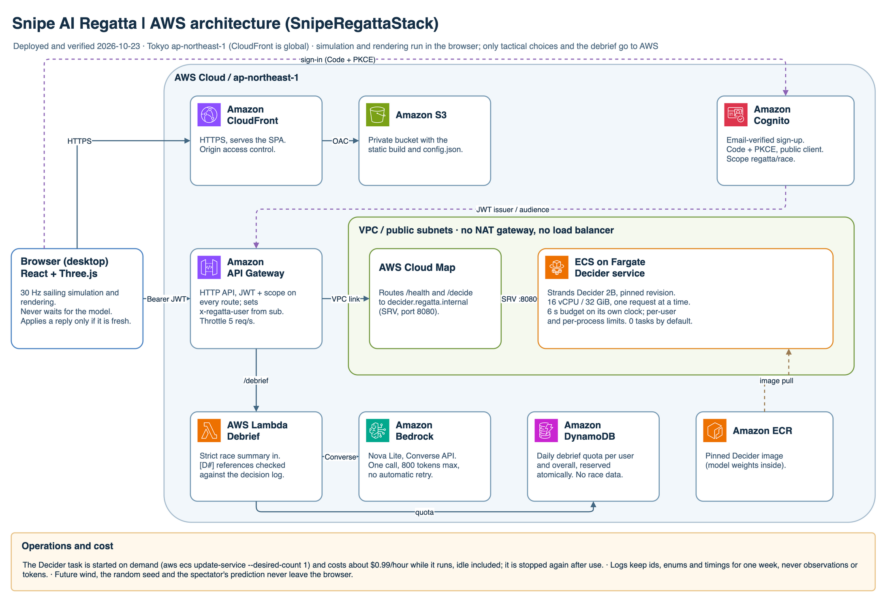
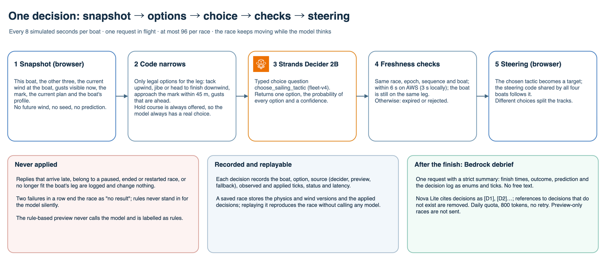

# Snipe AI Regatta

<p align="center"></p>

<p align="center"><a href="https://youtu.be/b2wlUMmQ0_k"><strong>▶ Watch the demo video</strong></a> · <a href="https://d1ot40x9jd3rql.cloudfront.net"><strong>⛵ Try the live demo</strong></a></p>

**Read the wind. Pick the winner.** Four Snipe dinghies race on a changing sea. Before the start you pick
the boat you think will win; then you watch. Each boat's tactics (tack now, hold the course, chase a gust,
round the mark, jibe) are chosen live by **Strands Decider 2B**, and after the finish **Amazon Bedrock**
writes a short debrief grounded in the decisions that were actually made.

A submission to the [AWS Agent Experience Hackathon: Strands Decider](https://builder.aws.com/build/hackathons/4f50957c-1d08-37ab-b11c-97516b9adeb4/agent-experience-hackathon-strands-decider).

**Tags: `#strands-decider-2b` `#tool-selection`** · License: [MIT](LICENSE) · [日本語 → README_ja.md](README_ja.md)

## Try the live demo

**https://d1ot40x9jd3rql.cloudfront.net** (desktop Chrome or Safari)

| Mode | What you need | What runs |
| --- | --- | --- |
| **Rule-based preview** | Nothing; no sign-in | The full race on fixed rules, always available and labelled as rules |
| **Real Strands Decider** | Create an account (email code), sign in, and the AWS worker must be running | Every tactic is chosen live by the Decider on AWS Fargate; after the finish, ask Bedrock for a debrief |

The Decider runs on a 16 vCPU Fargate task that costs about $0.99 per hour even when idle, so it is **stopped
by default and started on demand** (for judging or a demo). While it is stopped, the app says *"The AWS
decision worker is stopped"* and the real model cannot be selected; the preview still works. After a start,
the model is ready in about 3.5 minutes; press **Check model connection** in the app.

For the maintainer, starting and stopping the worker (the names come from the stack outputs):

```sh
aws cloudformation describe-stacks --stack-name SnipeRegattaStack --region ap-northeast-1 \
  --query "Stacks[0].Outputs[?OutputKey=='ClusterName' || OutputKey=='ServiceName']"
aws ecs update-service --cluster <ClusterName> --service <ServiceName> --desired-count 1   # start
aws ecs wait services-stable --cluster <ClusterName> --services <ServiceName>             # running
aws ecs update-service --cluster <ClusterName> --service <ServiceName> --desired-count 0   # stop
```

## How it plays

1. **Pick a winner.** Four boats with identical performance but different tactical profiles. Your pick is
   locked at the start and never sent to the AI.
2. **Watch the race.** A 30 Hz sailing simulation on a sea whose wind direction, wind speed and visible gusts
   change over time. Follow any boat, ride on board, or switch to an overview. Pause, resume or end at any time.
3. **See every decision.** A live feed shows which tactic each boat chose and whether it was applied, came
   too late, or was rejected, and labels the source of every decision (real Decider or rule preview).
4. **Check your pick.** Finish order decides the winner (ties count for everyone; no winner if nobody
   finishes). Replay the tracks, save the record, and ask Bedrock for a debrief.

| Boat | Profile given to the Decider |
| --- | --- |
| Aurora | Balance progress and risk |
| Zephyr | Seek visible pressure (gusts) |
| Coral | Prioritize windward progress |
| Jade | Exploit wind shifts and openings |

The profile is the only difference. Boat speed, turning and sail handling are the same for all four, so
tactics, not hidden bonuses, decide the race.

## How we use Strands Decider (`#tool-selection`)

The simulation runs in the browser and never waits for the model. Every 8 simulated seconds per boat (one
request in flight at a time, at most 96 per race), the browser takes a snapshot and asks the Decider one
**typed choice question**, `choose_sailing_tactic` (version `fleet-v4`):

| Option | When code offers it | What runs if chosen |
| --- | --- | --- |
| `hold_course` | always | keep the current plan |
| `tack_now` | upwind leg | turn through the wind to the opposite tack |
| `approach_mark` | upwind, within 45 m of the mark | round the mark to port |
| `jibe_now` | downwind leg | jibe to the opposite broad reach |
| `head_to_finish` | downwind leg | steer for the finish line |
| `seek_visible_pressure_<gust>` | a gust that is visible and ahead | steer toward that gust |

What we did on purpose:

- **Code narrows, the model chooses.** Code removes options that are illegal or pointless right now (wrong
  leg, a gust behind the boat). It never picks the "best" one for the model to rubber-stamp. A boat that is still
  racing always has at least two legal options, so the model always makes a real choice.
- **The choice changes the boat's course.** The selected tactic becomes a target that the same steering code
  every boat uses then follows. Different choices visibly split the fleet's tracks.
- **Only what a spectator could see.** The observation holds the boat, the other three boats, the current
  wind at the boat, the gusts visible now, the mark and the current plan. It never includes future wind, the
  random seed, or your prediction.
- **Late answers are discarded, never applied.** Each request carries the race id, epoch, sequence and boat. A
  reply that misses the deadline (3 s locally, 6 s on AWS), belongs to a paused or restarted race, or no
  longer fits the boat's leg is logged as expired or rejected and changes nothing. Two failures in a row end
  the race as "no result" instead of quietly substituting rules.
- **Honest labels.** The rule-based preview never calls the model and is always labelled as rules. Model
  confidence is never shown as a chance of winning.
- **Replays are deterministic.** A saved record contains the physics and wind versions and the applied
  decisions; replaying it reproduces the race without calling any model.

The Decider plumbing reuses the project's standalone decision package
([`apps/worker/src/photoprep_worker/decision_pattern/`](apps/worker/src/photoprep_worker/decision_pattern/),
explained in [docs/decision-pattern.md](docs/decision-pattern.md)): a typed question, the Decider call, and
validation of its probabilities. The sailing question and its options live in
[`apps/regatta-worker/local_server.py`](apps/regatta-worker/local_server.py).

## How we use Amazon Bedrock

After a race, one button asks **Nova Lite** (Converse API, Tokyo) for a 3–5 sentence debrief
([`apps/regatta-debrief/handler.py`](apps/regatta-debrief/handler.py)):

- The browser sends a **strict summary**: finish times, outcome, your pick, and the decision log as enums and
  ticks. There is no free text, so nothing in it can act as an instruction.
- Each decision is labelled `[D1]`, `[D2]`…; the model is told to cite them and not to invent reasoning or
  "this would have won" claims. **References to decisions that do not exist are removed** before the text is
  shown.
- One call per request, 800 output tokens at most, no automatic retry. A per-user and global daily quota is
  reserved atomically in DynamoDB before Bedrock is called.
- Races with only preview (rule) decisions are not sent to Bedrock.

## Architecture on AWS



How a single tactical decision flows, from the browser snapshot to the steering:



Editable source: [`snipe-regatta.drawio`](docs/architecture/diagrams/snipe-regatta.drawio) (two pages, official AWS icons), generated by
[`generate-regatta.py`](docs/architecture/diagrams/generate-regatta.py).

| Piece | Role |
| --- | --- |
| CloudFront + S3 (OAC) | Serves the static app from a private bucket. |
| Cognito | Self sign-up with email verification; Authorization Code + PKCE; tokens kept in memory only. |
| API Gateway HTTP API | JWT authorizer and scope on **every** route. It forwards the user id from the token and overwrites any client-supplied copy. |
| Fargate Decider service | Loads the pinned Decider once, answers one request at a time, enforces per-user and per-process limits and a 6 s budget timed on its own clock. Reached only through the VPC link: no load balancer, no NAT gateway, and **0 tasks unless started**. |
| Lambda + Bedrock + DynamoDB | The debrief described above. |

Infrastructure is [AWS CDK](apps/cdk/lib/regatta-stack.ts) with cdk-nag; the tests assert that every route
is authenticated, that only the VPC link can reach the task, that the worker starts at 0 tasks, and that the
Lambda may invoke only Nova Lite.

## What we measured

Numbers are from synthetic observations or a single real race, as noted. They describe speed and wiring, not
how good the tactics are.

| Check | Result | Record |
| --- | --- | --- |
| Decider on a Mac (MPS), 100 decisions | p50 1.2 s, p95 1.4 s, 0 failures | [local](docs/reviews/2026-10-22-fleet-validation.md) |
| Decider on Fargate, 4 vCPU, 100 decisions | p50 9.4 s, p95 11.4 s: too slow for real time | [cpu4](docs/reviews/2026-10-22-fleet-aws-cpu4-latency.json) |
| Decider on Fargate, 16 vCPU, 100 decisions | p50 3.1 s, p95 3.7 s, max 3.8 s → cloud deadline set to 6 s | [cpu16](docs/reviews/2026-10-22-fleet-aws-cpu16-latency.json) |
| Signed-in race on AWS | 47/47 decisions returned in time (p50 2.3 s, p95 2.7 s through the API); 4 boats finished; tack, hold and jibe applied; a reply that arrived after its boat finished was rejected | [AWS run](docs/reviews/2026-10-23-regatta-aws-validation.md) |
| Bedrock debrief on AWS | Japanese debrief citing only logged decisions | same |
| Unauthenticated calls | 401 on every route; CORS only for the app's origin | same |
| Simple navigation cases (local) | the expected option in 16 of 16 | [local](docs/reviews/2026-10-22-fleet-validation.md) |

A bug found only on AWS: a laptop whose clock was 4 seconds slow made every reply "expired", because the server
trusted the browser's absolute deadline. The server now measures its budget from when it receives the
request.

## Run it locally

You need Node.js with pnpm 10.32.1. For the real model you also need Python 3.12 with
[uv](https://docs.astral.sh/uv/) and the pinned model cache.

```sh
pnpm install --frozen-lockfile
pnpm --filter regatta-web dev          # http://127.0.0.1:5174
```

Without a model, choose **Rule-based preview**: the race runs on fixed rules, labelled as such. To use the
real Decider on your machine (Apple silicon GPU shown; `--device cpu` also works), start the local bridge in
another terminal. It reads the pinned model cache and does not download anything:

```sh
(cd apps/worker && uv sync --frozen)
apps/worker/.venv/bin/python apps/regatta-worker/local_server.py --device mps
```

More detail: [quickstart](specs/003-regatta-spectator/quickstart.md). Tests (none of them call AWS):

```sh
pnpm --filter sailing-sim test         # 44: sailing, wind, fleet, tactics
pnpm --filter regatta-web test         # 37: runtime, deadlines, replay, cloud client
pnpm --filter regatta-web test:e2e     # Playwright spectator flow (preview mode)
apps/worker/.venv/bin/python -m pytest -q apps/regatta-worker/tests -c apps/regatta-worker/pyproject.toml   # 28
(cd apps/regatta-debrief && ../worker/.venv/bin/python -m pytest -q)                                        # 15
pnpm --filter cdk test                 # includes 8 assertions for the regatta stack
```

## Deploy to AWS

You need Docker, the AWS CLI signed in, Bedrock access to Nova Lite in Tokyo, and `cdk bootstrap` for
`ap-northeast-1`. The 16 vCPU worker costs about **$0.99 per hour while it runs**, idle included. Start it
only to play or record, then stop it.

```sh
# 1. Images: the pinned base (downloads the model at build time), then the Decider service on top
docker build --platform linux/amd64 -f apps/worker/Dockerfile -t photoprep-worker:base .
docker build --platform linux/amd64 --build-arg BASE_IMAGE=photoprep-worker:base \
  -f apps/regatta-worker/Dockerfile -t regatta-worker:decider-v2 .

# 2. An ECR repository (the probe stack also runs the latency gate), then push with a new tag
cd apps/cdk && pnpm exec cdk deploy --app 'pnpm exec ts-node bin/regatta-probe.ts' \
  -o cdk.out-regatta-probe -c regatta:probeCpu=16384 --outputs-file ../../.local/regatta/probe-outputs.json
docker tag regatta-worker:decider-v2 <RepositoryUriOutput>:decider-v2 && docker push <RepositoryUriOutput>:decider-v2

# 3. The app stack (worker stopped), then publish the web app
cd apps/cdk && pnpm exec cdk deploy --app 'pnpm exec ts-node bin/regatta.ts' -o cdk.out-regatta \
  -c regatta:repositoryName=<repository name> -c regatta:imageTag=decider-v2 \
  -c regatta:workerCpu=16384 -c regatta:desiredCount=0 -c regatta:budgetMs=6000 \
  --outputs-file ../../.local/regatta/stack-outputs.json
sh scripts/regatta-publish.sh .local/regatta/stack-outputs.json

# 4. Start the worker (ready in about 3.5 minutes), and stop it afterwards
aws ecs update-service --cluster <ClusterName> --service <ServiceName> --desired-count 1
aws ecs update-service --cluster <ClusterName> --service <ServiceName> --desired-count 0
```

Open the `SiteUrl`, create an account, sign in, and choose **Real Strands Decider**. To remove everything,
delete `SnipeRegattaStack` and `RegattaProbeStack` (the ECR images go with it), plus the log groups that CDK's
helper functions leave behind. Full runbook: [AWS validation](specs/003-regatta-spectator/aws-validation.md).

## Status

| Item | State (2026-10-23) |
| --- | --- |
| Game | Prediction, four-boat race, live decision feed, three camera views, result, replay and record export; Japanese and English |
| Real Decider | Locally (Mac) and on AWS Fargate (16 vCPU), end to end in a signed-in race |
| Bedrock debrief | Working on AWS |
| AWS environment | **Live** at https://d1ot40x9jd3rql.cloudfront.net (redeployed 2026-10-23 after the recorded verification). The Decider worker is stopped by default and started on demand |
| Not measured | Tactical quality beyond the 16 simple cases; fairness of profiles and start positions over many races; stability across many races and devices; whether each debrief sentence matches the log (only references are checked) |

## Repository layout

```text
apps/regatta-web/        React + MUI + Three.js spectator game, cloud client, Playwright test
apps/regatta-worker/     Decider service (Fargate) and local bridge, latency probe, tests
apps/regatta-debrief/    Bedrock debrief Lambda and tests
packages/sailing-sim/    Deterministic sailing physics, wind, fleet, tactics (TypeScript, 30 Hz)
apps/cdk/                CDK: SnipeRegattaStack, RegattaProbeStack (and the legacy photo-app stack)
apps/worker/             Pinned model image and the reusable decision_pattern package
specs/003-regatta-spectator/   Current spec, plan, tasks and AWS runbook
docs/reviews/            Measurements and validation records
docs/brand/regatta/      Cover image (SVG + PNG, generator script)
```

## Built with

React 19, TypeScript, Vite 8, Material UI, Three.js · Python 3.12, uv, pydantic · Strands Decider 2B
(`StrandsAgents/strands-decider-2B-qwen3.5-v1-2610`, pinned revision) · Amazon Bedrock Nova Lite · AWS
CloudFront, S3, Cognito, API Gateway, ECS on Fargate, ECR, Lambda, DynamoDB, Cloud Map · AWS CDK v2 with
cdk-nag · Vitest, Playwright, pytest, Jest, Biome, Oxlint, Ruff, Knip, jscpd · GitHub Spec Kit.

## History

This repository started as a photo-preparation assistant that used the same Decider pattern. Its code stays
in `apps/` and `specs/001-pre-photo-grooming-assist/`; its README, documents and AWS evidence were removed
from `docs/` and remain in Git history: [the photo-assistant README at commit 5cc9448](https://github.com/mashharuki/2026-Agent-Experience-Hackathon/blob/5cc9448/docs/legacy/photo-assistant.md).

## License

[MIT](LICENSE). Model weights are downloaded from their publishers under their own licenses; see
[third-party notices](docs/THIRD_PARTY_NOTICES.md).
