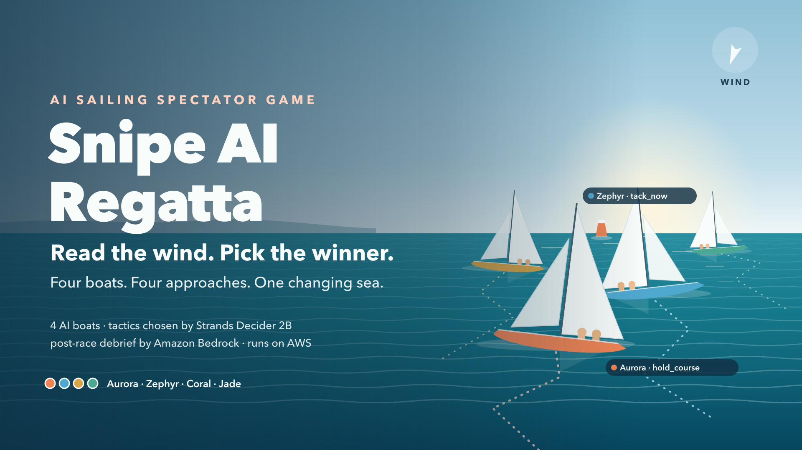
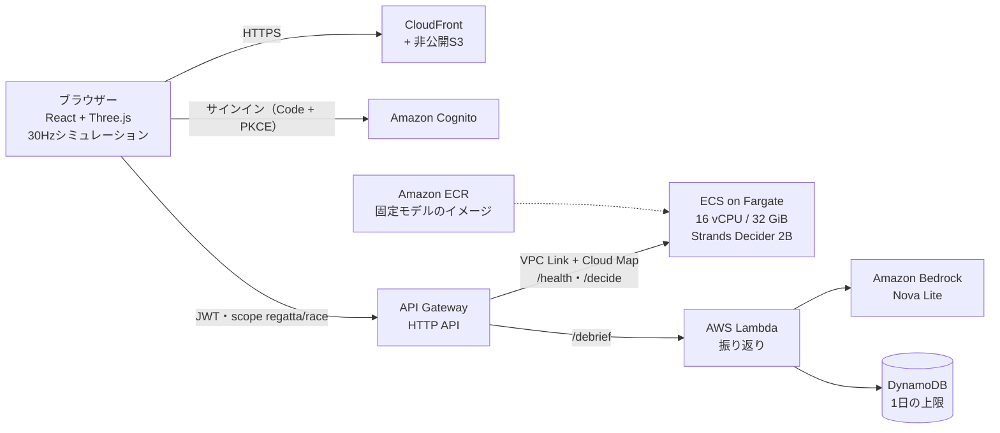

# Snipe AI Regatta

<p align="center"></p>

<p align="center"><a href="https://youtu.be/b2wlUMmQ0_k"><strong>▶ デモ動画を見る</strong></a> · <a href="https://d1ot40x9jd3rql.cloudfront.net"><strong>⛵ ライブデモで遊ぶ</strong></a></p>

**風を読んで、勝者を選べ。** 変化する海面で、スナイプ級ヨット4艇がレースをします。スタート前に勝つと思う艇を1艇選び、あとは観戦します。
各艇の戦術（今タックする、針路を維持する、ブローを追う、マークを回る、ジャイブする）は **Strands Decider 2B** がその場で選びます。
フィニッシュ後は **Amazon Bedrock** が、実際に下された判断だけをもとに短い振り返りを書きます。

[AWS Agent Experience Hackathon: Strands Decider](https://builder.aws.com/build/hackathons/4f50957c-1d08-37ab-b11c-97516b9adeb4/agent-experience-hackathon-strands-decider) への応募作品です。

**Tags: `#strands-decider-2b` `#tool-selection`** · License: [MIT](LICENSE) · [English → README.md](README.md)

## ライブデモ

**https://d1ot40x9jd3rql.cloudfront.net**（デスクトップのChromeまたはSafari）

| モード | 必要なもの | 動くもの |
| --- | --- | --- |
| **ルールのプレビュー** | なし（サインイン不要） | 固定ルールでレース全体を再現。いつでも使え、ルールであることを表示 |
| **Strands Decider 実モデル** | アカウント作成（メールの確認コード）とサインイン、AWSのワーカーが起動していること | 全戦術をAWS Fargate上のDeciderがその場で選択。フィニッシュ後はBedrockに振り返りを依頼できる |

Deciderは16 vCPUのFargateタスクで動き、待機中も1時間あたり約$0.99かかります。そのため**普段は停止しておき、審査やデモのときだけ起動**します。
停止中は画面に「AWSの判断ワーカーは停止中です」と表示され、実モデルは選べません。プレビューは使えます。
起動後、約3.5分でモデルの準備ができます。画面の **モデル接続を確認** を押してください。

管理者向け：ワーカーの起動と停止（名前はスタックの出力から取得します）

```sh
aws cloudformation describe-stacks --stack-name SnipeRegattaStack --region ap-northeast-1 \
  --query "Stacks[0].Outputs[?OutputKey=='ClusterName' || OutputKey=='ServiceName']"
aws ecs update-service --cluster <ClusterName> --service <ServiceName> --desired-count 1   # 起動
aws ecs wait services-stable --cluster <ClusterName> --services <ServiceName>             # 稼働を待つ
aws ecs update-service --cluster <ClusterName> --service <ServiceName> --desired-count 0   # 停止
```

## 遊び方

1. **勝者を予想する。** 4艇の性能は同じで、戦術の方針だけが違います。予想はスタート時に固定され、AIには渡しません。
2. **レースを観戦する。** 30Hzの帆走シミュレーションです。風向・風速・目に見えるブローが時間とともに変わります。好きな艇の追従、艇上視点、俯瞰を切り替えられ、一時停止・再開・途中終了もいつでもできます。
3. **すべての判断を見る。** 各艇が選んだ戦術と、それが適用されたか、間に合わなかったか、不採用になったかを、判断の出所（実Deciderか、ルールのプレビューか）とあわせて表示します。
4. **予想を答え合わせする。** 勝者はフィニッシュ順で決まります（同着なら全員が勝者、誰も完走しなければ勝者なし）。航跡を再生し、記録を保存し、Bedrockに振り返りを頼めます。

| 艇 | Deciderに渡す方針 |
| --- | --- |
| Aurora | 前進とリスクのバランス |
| Zephyr | 見えているブローを拾う |
| Coral | 風上への効率を優先 |
| Jade | 風の振れや好機を狙う |

違いは方針だけです。艇速・回頭・帆の扱いは4艇とも同じなので、隠れた性能差ではなく戦術が勝敗を分けます。

## Strands Deciderの使い方（`#tool-selection`）

シミュレーションはブラウザーで動き、モデルの返答を待って止まることはありません。
各艇について8シミュレーション秒ごとに（同時に処理する判断は1件、1レース最大96件）、ブラウザーがその時点の状況をまとめ、
Deciderに**型付きの選択問題** `choose_sailing_tactic`（版 `fleet-v4`）を1問出します。

| 選択肢 | コードが候補に入れる条件 | 選ばれたときに実行すること |
| --- | --- | --- |
| `hold_course` | 常に | 今の計画を続ける |
| `tack_now` | 風上レグ | 風位を越えて反対タックへ |
| `approach_mark` | 風上レグで、マークまで45m以内 | マークを左回りに回る |
| `jibe_now` | 風下レグ | 反対側のブロードリーチへジャイブ |
| `head_to_finish` | 風下レグ | フィニッシュラインへ向かう |
| `seek_visible_pressure_<ブロー>` | 目に見えていて、進行方向にあるブロー | そのブローへ向かう |

意図して決めたこと：

- **候補を絞るのはコード、選ぶのはモデル。** 今は不正・無意味な選択肢（レグが違う、後ろにあるブローなど）はコードが外します。ただし「最善手」をコードが決めて、モデルに追認させることはしません。合法な候補が1つだけなら、モデルは呼ばずに `policy` として記録します。
- **選んだ戦術で航路が変わる。** 選ばれた戦術は目標針路になり、全艇共通の操舵コードがそれを追います。選択が違えば、航跡がはっきり分かれます。
- **観客に見えることだけを渡す。** 観測に含めるのは、自艇、他の3艇、自艇位置の今の風、今見えているブロー、マーク、今の計画だけです。未来の風、乱数のseed、あなたの予想は含めません。
- **遅れた返答は捨てて、適用しない。** 判断にはレースID・epoch・連番・艇を付けます。期限（ローカル3秒、AWS 6秒）に遅れた返答、一時停止や再戦の前のレースへの返答、艇のレグと合わなくなった返答は、期限切れ・不採用として記録するだけで何も変えません。2回続けて失敗したら、ルールで黙って代用せず「不成立」としてレースを終えます。
- **出所を正直に表示する。** ルールのプレビューはモデルを呼ばず、常にルールと表示します。モデルのconfidenceを勝率として見せることはしません。
- **再生は決定的。** 保存した記録には物理・風の版と、適用した判断が入っています。再生するとモデルを呼ばずに同じレースを再現します。

Deciderの呼び出し部分は、このプロジェクトの独立した判断パッケージを再利用しています
（[`apps/worker/src/photoprep_worker/decision_pattern/`](apps/worker/src/photoprep_worker/decision_pattern/)、
説明は [docs/decision-pattern.md](docs/decision-pattern.md)）。型付きの問い、Deciderの呼び出し、確率の検証を担います。
ヨットの問いと選択肢は [`apps/regatta-worker/local_server.py`](apps/regatta-worker/local_server.py) にあります。

## Amazon Bedrockの使い方

レース後、ボタン1つで **Nova Lite**（Converse API、東京）に3〜5文の振り返りを頼みます
（[`apps/regatta-debrief/handler.py`](apps/regatta-debrief/handler.py)）。

- ブラウザーは**厳密な要約**だけを送ります。中身は、フィニッシュ時刻、結果、あなたの予想、列挙値とtickだけの判断ログです。自由文がないので、指示として働く文字列は入りません。
- 各判断に `[D1]`、`[D2]`… と番号を付け、モデルにはそれを引用するよう、また内部の思考や「この手なら勝てた」といった主張を作らないよう指示します。**存在しない判断を指す番号は、表示前に削除します。**
- 1回の要求につき呼び出しは1回、出力は最大800トークンで、自動の再試行はしません。Bedrockを呼ぶ前に、利用者ごとと全体の1日の上限をDynamoDBで原子的に予約します。
- ルールのプレビューの判断しかないレースは、Bedrockに送りません。

## AWS構成



| 部品 | 役割 |
| --- | --- |
| CloudFront＋S3（OAC） | 非公開バケットから静的アプリを配信 |
| Cognito | メール確認つきの自己登録、Authorization Code＋PKCE、トークンはメモリにだけ保持 |
| API Gateway HTTP API | **すべての**ルートにJWT認証とscope。トークンの利用者IDを転送し、クライアントが送った同名ヘッダーは上書き |
| Fargate上のDecider | 固定revisionのDeciderを一度だけ読み込み、1件ずつ処理。利用者ごと・プロセスごとの上限と、自分の時計で測る6秒の予算を守る。到達経路はVPC Linkだけで、ロードバランサーもNATもなし。**起動しない限り0台** |
| Lambda＋Bedrock＋DynamoDB | 上記の振り返り |

インフラは [AWS CDK](apps/cdk/lib/regatta-stack.ts)＋cdk-nagで定義しています。テストでは、全ルートが認証つきであること、タスクにはVPC Linkからしか届かないこと、ワーカーが0台で始まること、LambdaはNova Liteしか呼べないことを検査しています。

## 計測結果

数値は、合成した観測か、実際の1レースで測ったものです（表に明記）。速度と配線の確認であり、戦術の上手さを示すものではありません。

| 確認 | 結果 | 記録 |
| --- | --- | --- |
| Mac（MPS）でDecider、100判断 | p50 1.2秒、p95 1.4秒、失敗0 | [ローカル](docs/reviews/2026-10-22-fleet-validation.md) |
| Fargate 4 vCPUでDecider、100判断 | p50 9.4秒、p95 11.4秒：リアルタイムには遅すぎる | [cpu4](docs/reviews/2026-10-22-fleet-aws-cpu4-latency.json) |
| Fargate 16 vCPUでDecider、100判断 | p50 3.1秒、p95 3.7秒、最大3.8秒 → AWSの期限を6秒に設定 | [cpu16](docs/reviews/2026-10-22-fleet-aws-cpu16-latency.json) |
| AWS上でのサインイン済みレース | 47/47の判断が期限内に返答（API経由でp50 2.3秒、p95 2.7秒）。4艇完走。タック・針路維持・ジャイブを適用。艇のフィニッシュ後に届いた返答は不採用 | [AWS通し](docs/reviews/2026-10-23-regatta-aws-validation.md) |
| AWS上のBedrock振り返り | 記録された判断だけを引用した日本語の振り返り | 同上 |
| 未認証の呼び出し | 全ルートで401。CORSはアプリの配信元だけ許可 | 同上 |
| 単純な航路ケース（ローカル） | 16件中16件で期待した選択肢 | [ローカル](docs/reviews/2026-10-22-fleet-validation.md) |

AWSで初めて見つかった不具合：時計が4秒遅れていたノートPCでは、判断がすべて「期限切れ」になりました。サーバーがブラウザーの絶対時刻の期限を信用していたためです。今は、サーバーが受信した時点から自分の時計で予算を測ります。

## ローカルで動かす

Node.jsとpnpm 10.32.1が必要です。実モデルを使う場合は、Python 3.12と[uv](https://docs.astral.sh/uv/)、固定revisionのモデルキャッシュも必要です。

```sh
pnpm install --frozen-lockfile
pnpm --filter regatta-web dev          # http://127.0.0.1:5174
```

モデルなしなら **ルールのプレビュー** を選びます。レースは固定ルールで動き、そのことが表示されます。
手元で実Deciderを使う場合は、別のターミナルでローカルの橋渡しサーバーを起動します（例はApple siliconのGPU。`--device cpu` でも動きます）。モデルキャッシュを読むだけで、ダウンロードはしません。

```sh
(cd apps/worker && uv sync --frozen)
apps/worker/.venv/bin/python apps/regatta-worker/local_server.py --device mps
```

詳しくは[クイックスタート](specs/003-regatta-spectator/quickstart.md)。テスト（どれもAWSを呼びません）：

```sh
pnpm --filter sailing-sim test         # 44件：帆走・風・艇団・戦術
pnpm --filter regatta-web test         # 37件：実行時の動作・期限・再生・クラウド接続
pnpm --filter regatta-web test:e2e     # Playwrightで観戦の流れ（プレビュー）
apps/worker/.venv/bin/python -m pytest -q apps/regatta-worker/tests -c apps/regatta-worker/pyproject.toml   # 28件
(cd apps/regatta-debrief && ../worker/.venv/bin/python -m pytest -q)                                        # 15件
pnpm --filter cdk test                 # レガッタのスタックの検査8件を含む
```

## AWSへのデプロイ

Docker、サインイン済みのAWS CLI、東京リージョンでのBedrock Nova Liteの利用許可、`ap-northeast-1` の `cdk bootstrap` が必要です。
16 vCPUのワーカーは、**動いている間は待機中も含めて1時間あたり約$0.99** かかります。遊ぶときや撮影のときだけ起動し、終わったら止めてください。

```sh
# 1. イメージ：固定モデル入りのベース（ビルド時にモデルを取得）と、その上のDeciderサービス
docker build --platform linux/amd64 -f apps/worker/Dockerfile -t photoprep-worker:base .
docker build --platform linux/amd64 --build-arg BASE_IMAGE=photoprep-worker:base \
  -f apps/regatta-worker/Dockerfile -t regatta-worker:decider-v2 .

# 2. ECRリポジトリ（計測用スタック。遅延の計測にも使う）を作り、新しいタグでプッシュ
cd apps/cdk && pnpm exec cdk deploy --app 'pnpm exec ts-node bin/regatta-probe.ts' \
  -o cdk.out-regatta-probe -c regatta:probeCpu=16384 --outputs-file ../../.local/regatta/probe-outputs.json
docker tag regatta-worker:decider-v2 <RepositoryUriOutput>:decider-v2 && docker push <RepositoryUriOutput>:decider-v2

# 3. アプリのスタック（ワーカーは停止のまま）とWebアプリの公開
cd apps/cdk && pnpm exec cdk deploy --app 'pnpm exec ts-node bin/regatta.ts' -o cdk.out-regatta \
  -c regatta:repositoryName=<リポジトリ名> -c regatta:imageTag=decider-v2 \
  -c regatta:workerCpu=16384 -c regatta:desiredCount=0 -c regatta:budgetMs=6000 \
  --outputs-file ../../.local/regatta/stack-outputs.json
sh scripts/regatta-publish.sh .local/regatta/stack-outputs.json

# 4. ワーカーを起動（準備完了まで約3.5分）し、終わったら止める
aws ecs update-service --cluster <ClusterName> --service <ServiceName> --desired-count 1
aws ecs update-service --cluster <ClusterName> --service <ServiceName> --desired-count 0
```

`SiteUrl` を開き、アカウントを作ってサインインし、**Strands Decider 実モデル** を選びます。
すべて削除するときは、`SnipeRegattaStack` と `RegattaProbeStack`（ECRのイメージも一緒に消えます）を削除し、CDKの補助関数が残すロググループも消します。
手順の全体：[AWS検証](specs/003-regatta-spectator/aws-validation.md)。

## 現状

| 項目 | 状態（2026-10-23） |
| --- | --- |
| ゲーム | 予想、4艇のレース、判断のライブ表示、3つの視点、結果、再生、記録の書き出し。日本語・英語 |
| 実Decider | ローカル（Mac）とAWS Fargate（16 vCPU）で、サインイン済みのレースを通しで確認 |
| Bedrockの振り返り | AWS上で動作を確認 |
| AWS環境 | **公開中**：https://d1ot40x9jd3rql.cloudfront.net（記録した検証のあと、2026-10-23に再デプロイ）。Deciderのワーカーは普段は停止し、必要なときだけ起動 |
| 未計測 | 16件の単純なケース以外の戦術の質、多数のレースでの方針・開始位置の公平さ、多数のレースや別端末での安定性、振り返りの各文が判断ログと一致するか（確認しているのは参照番号だけ） |

## リポジトリの構成

```text
apps/regatta-web/        React＋MUI＋Three.jsの観戦ゲーム、クラウド接続、Playwrightテスト
apps/regatta-worker/     Deciderサービス（Fargate）とローカルの橋渡し、遅延の計測、テスト
apps/regatta-debrief/    Bedrockの振り返りLambdaとテスト
packages/sailing-sim/    決定的な帆走物理・風・艇団・戦術（TypeScript、30Hz）
apps/cdk/                CDK：SnipeRegattaStack、RegattaProbeStack（旧写真アプリのスタックも）
apps/worker/             固定モデルのイメージと、再利用できる decision_pattern パッケージ
specs/003-regatta-spectator/   現行の仕様・計画・タスク・AWS手順
docs/reviews/            計測と検証の記録
docs/brand/regatta/      カバー画像（SVG・PNG・生成スクリプト）
```

## 使っている技術

React 19、TypeScript、Vite 8、Material UI、Three.js · Python 3.12、uv、pydantic · Strands Decider 2B
（`StrandsAgents/strands-decider-2B-qwen3.5-v1-2610`、revision固定） · Amazon Bedrock Nova Lite · AWS
CloudFront、S3、Cognito、API Gateway、ECS on Fargate、ECR、Lambda、DynamoDB、Cloud Map · AWS CDK v2＋cdk-nag ·
Vitest、Playwright、pytest、Jest、Biome、Oxlint、Ruff、Knip、jscpd · GitHub Spec Kit。

## これまでの経緯

このリポジトリは、同じDeciderの判断パターンを使った写真の身支度アシスタントとして始まりました。
コードは `apps/` と `specs/001-pre-photo-grooming-assist/` に残しています。README・文書・AWSでの検証記録は `docs/` から削除し、Gitの履歴に残しています：[コミット5cc9448時点の写真アプリのREADME](https://github.com/mashharuki/2026-Agent-Experience-Hackathon/blob/5cc9448/docs/legacy/photo-assistant_ja.md)。

## ライセンス

[MIT](LICENSE)。モデルの重みは、各公開元のライセンスのもとで取得します。[第三者ライセンス](docs/THIRD_PARTY_NOTICES.md)を参照してください。
